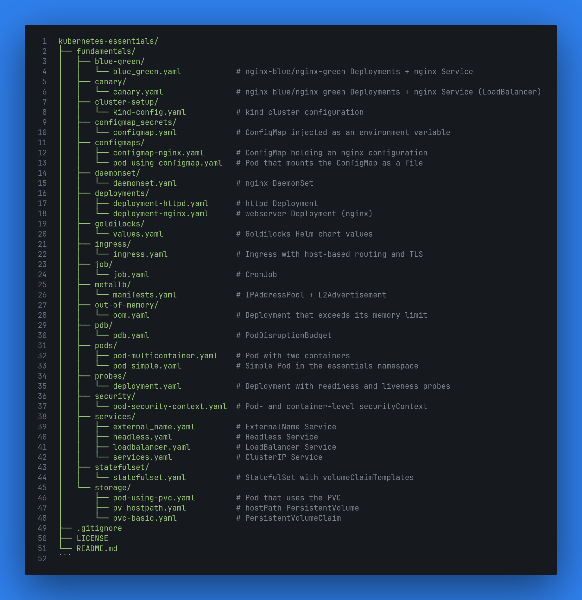

# Kubernetes Essentials

<p align="justify">
   
</p>

A Kubernetes study repository organized by topic. Each directory under `fundamentals/` holds the manifests used to study one resource or concept of the platform: Pods, Deployments, DaemonSets, StatefulSets, CronJobs, ConfigMaps, probes, PodDisruptionBudgets, Services, Ingress, persistent storage, security context, deployment strategies (blue-green and canary), and resource recommendations with Goldilocks.

The topics are independent of each other. The manifests are not meant to work together, and each directory can be studied and applied on its own.

The repository also includes the configuration for a local multi-node [kind](https://kind.sigs.k8s.io/) cluster to apply the examples to. There is no application code, scripts, or automation: the content is YAML manifests applied with `kubectl`, plus one Helm values file.

## Technologies

| Tool | Role in the project |
| ---- | ------------------- |
| Kubernetes | Target platform for every manifest (built-in APIs `v1`, `apps/v1`, `batch/v1`, `policy/v1`, and `networking.k8s.io/v1`) |
| kind | Local cluster with 1 control-plane node and 2 workers (`cluster-setup/kind-config.yaml`) |
| kubectl | Applying, inspecting, and deleting the manifests |
| Helm | Installing Goldilocks with `goldilocks/values.yaml` |
| MetalLB | External IPs for `LoadBalancer` Services on kind (`metallb/`) |
| Ingress controller | Required by `ingress/`; must serve the `nginx` IngressClass |
| Goldilocks, VPA, and metrics-server | Request and limit recommendations (`goldilocks/`) |

Container images used in the examples: `nginx`, `httpd`, `alpine`, `busybox`, and `valentinomiazzo/jvm-memory-test`.

## Repository structure



`.gitignore` keeps out of version control: kubeconfigs, `.env` files, keys and certificates (`*.key`, `*.crt`, `*.pem`), `*-secret.yaml` files and the `secrets/` directory, Helm packages, Terraform state, logs, and editor and OS files.

## Local cluster with kind

[`fundamentals/cluster-setup/kind-config.yaml`](fundamentals/cluster-setup/kind-config.yaml) defines a three-node cluster:

| Node (cluster `kind`) | Role | Configuration |
| --------------------- | ---- | ------------- |
| `kind-control-plane` | control-plane | Label `ingress-ready=true`; host ports `80`, `443`, and `8080` (`0.0.0.0`) mapped to the node |
| `kind-worker`, `kind-worker2` | worker | Run the workloads |

The `ingress-ready=true` label and the port 80/443 mappings let an Ingress controller running on the control-plane node receive requests sent to the host's `localhost`, following the pattern in the [kind Ingress documentation](https://kind.sigs.k8s.io/docs/user/ingress/).

```bash
kind create cluster --config fundamentals/cluster-setup/kind-config.yaml
```

To delete the cluster: `kind delete cluster`.

Cluster characteristics that affect the examples:

- The control-plane node has the `node-role.kubernetes.io/control-plane:NoSchedule` taint. Pods without a matching toleration, including the DaemonSet's, run only on the two workers.
- The default StorageClass is `standard` (provisioner `rancher.io/local-path`), used by the StatefulSet and by the PVC in `storage/`.
- The nodes live on the `kind` Docker network, which the MetalLB IP range is taken from.

## Using the examples

Every directory under `fundamentals/` (except `cluster-setup/` and `goldilocks/`) contains Kubernetes manifests that can be applied on their own.

- Resources without an explicit `namespace` go to the current context's namespace (`default` unless changed). The exceptions are `pods/pod-simple.yaml` (`essentials`) and `metallb/manifests.yaml` (`metallb-system`). `blue_green.yaml`, `canary.yaml`, and `deployment-httpd.yaml` pin the `default` namespace.
- Don't apply `fundamentals/` recursively: `kind-config.yaml` and `goldilocks/values.yaml` are not Kubernetes manifests, and several examples share resource names.
- Because each topic was written independently, some of them reuse the same resource names. Apply **one example at a time** and delete it before applying the next. Applying one on top of another either overwrites the previous configuration or fails on immutable fields, such as a Deployment's `selector` or a Service's `clusterIP`.

| Name | Kind | Defined in |
| ---- | ---- | ---------- |
| `nginx` | Service | `services/headless.yaml`, `blue-green/blue_green.yaml`, `canary/canary.yaml` |
| `nginx-service` | Service | `services/services.yaml`, `services/loadbalancer.yaml` |
| `nginx` | Deployment | `probes/deployment.yaml`, `configmap_secrets/configmap.yaml` |
| `nginx-blue`, `nginx-green` | Deployment | `blue-green/blue_green.yaml`, `canary/canary.yaml` |

### Overview

| Directory | Resources | Concept | Prerequisites |
| --------- | --------- | ------- | ------------- |
| `pods/` | Pod | Simple Pod and multi-container Pod | `essentials` namespace (for `pod-simple.yaml`) |
| `deployments/` | Deployment | Replicas and the RollingUpdate strategy | — |
| `daemonset/` | DaemonSet | One Pod per eligible node | — |
| `statefulset/` | StatefulSet | Stable identity and per-replica volume | `services/headless.yaml`; default StorageClass |
| `job/` | CronJob | Scheduled execution | — |
| `out-of-memory/` | Deployment | Requests/limits and `OOMKilled` | — |
| `configmaps/` | ConfigMap, Pod | ConfigMap mounted as a file | ConfigMap applied before the Pod |
| `configmap_secrets/` | ConfigMap, Deployment | ConfigMap as an environment variable | — |
| `probes/` | Deployment | Readiness and liveness probes | — |
| `pdb/` | PodDisruptionBudget | Limit on voluntary disruptions | Pods labeled `app: nginx` |
| `services/` | Service | ClusterIP, LoadBalancer, headless, and ExternalName | Pods labeled `app: nginx-service`; MetalLB (for LoadBalancer) |
| `metallb/` | IPAddressPool, L2Advertisement | External IPs for LoadBalancer | MetalLB installed |
| `ingress/` | Ingress | Host-based routing and TLS | Ingress controller, TLS Secret, `nginx` and `httpd` Services |
| `storage/` | PersistentVolume, PVC, Pod | Persistent storage | — |
| `security/` | Pod | `securityContext` | — |
| `blue-green/` | Deployment, Service | Switching versions through the Service selector | — |
| `canary/` | Deployment, Service | Splitting traffic by replica ratio | MetalLB (to get an external IP) |
| `goldilocks/` | Helm values | Request and limit recommendations | Helm |

## Examples

### Pods — `pods/`

- **`pod-simple.yaml`**: Pod `nginx-essentials` in the `essentials` namespace, using the `nginx:1.14.2` image and declaring port 80. The namespace must exist before the Pod is applied.
- **`pod-multicontainer.yaml`**: Pod `multicontainer-pod` with two containers, `httpd` and `debug` (`alpine`). The `debug` container runs `sleep 999999999`. As the comment in the manifest explains, without that command `alpine` exits immediately and the Pod goes into `CrashLoopBackOff`. The containers share the Pod's network, so `debug` reaches `httpd` on `localhost`.

### Deployments — `deployments/`

- **`deployment-nginx.yaml`**: Deployment `webserver` with 3 `nginx` replicas, label `app: webserver`, and annotation `environment: qa`.
- **`deployment-httpd.yaml`**: Deployment `httpd` (namespace `default`) with 1 `httpd` replica. The `RollingUpdate` strategy is spelled out (`maxSurge` and `maxUnavailable` at 25%), along with `revisionHistoryLimit: 10` and `progressDeadlineSeconds: 600`.

### DaemonSet — `daemonset/`

`daemonset.yaml` creates the `nginx` DaemonSet (label `app: nginx`), which keeps one `nginx` Pod on every eligible node. It has no toleration for the control-plane taint, so on the kind cluster it creates two Pods, one per worker.

### StatefulSet and headless Service — `statefulset/`

- **`statefulset/statefulset.yaml`**: StatefulSet `nginx-master` with 3 `nginx` replicas and `serviceName: nginx`. The `nginx-html` volume claim template (1G, `ReadWriteOnce`) is mounted at `/usr/share/nginx/html`.
- **`services/headless.yaml`**: Service `nginx` with `clusterIP: None` and selector `app: nginx`. It is the Service referenced by `serviceName` and gives each Pod its own DNS record, such as `nginx-master-0.nginx.default.svc.cluster.local`.

Apply the headless Service before the StatefulSet. The Pods are created in order (`nginx-master-0`, `-1`, `-2`), and each one gets its own PVC (`nginx-html-nginx-master-<n>`), provisioned by the default StorageClass. The PVCs remain after the StatefulSet is deleted.

### CronJob — `job/`

Despite the directory and file names, `job.yaml` defines a **CronJob** (`echo-command`). With the `* * * * *` schedule, it creates a Job every minute. The Job's Pod runs `echo "Just testing"` in an `alpine` container (named `sleep`), with `restartPolicy: OnFailure`. New Jobs keep being created until the CronJob is deleted.

### Memory limit — `out-of-memory/`

`oom.yaml` creates the `oom-deployment` Deployment with the [`valentinomiazzo/jvm-memory-test`](https://github.com/valentinomiazzo/docker-jvm-memory-test) image, a JVM application that keeps holding on to more memory:

- `requests`: `cpu: 100m`, `memory: 512M`; `limits`: `cpu: 1`, `memory: 1G`.
- `ALLOC_HEAP_MB=100`: the application retains another 100 MB of heap every cycle (1 second by default).
- `MAX_HEAP_SIZE_MB=2000`: the JVM's maximum heap is set above the container's memory limit.

As a result, the container hits its `1G` limit before the JVM reaches its maximum heap. The process is terminated, the Pod's `Last State` shows reason `OOMKilled`, and the kubelet restarts the container.

### ConfigMap mounted as a file — `configmaps/`

- **`configmap-nginx.yaml`**: ConfigMap `nginx-cm` with the key `nginx-custom-config.conf`, which holds an nginx `server` block listening on port **8888** and serving `/usr/share/nginx/html`.
- **`pod-using-configmap.yaml`**: Pod `nginx-cm` (label `role: web`) that mounts the ConfigMap at `/etc/nginx/conf.d`, projecting the key as the file `default.conf`. The volume replaces the whole directory, so nginx only loads this configuration and listens on 8888 instead of 80.

The ConfigMap must be applied before the Pod.

### ConfigMap as an environment variable — `configmap_secrets/`

`configmap.yaml` defines:

- the `nginx-demo` ConfigMap, with the key `virtual_host: vhost1.localhost.com`;
- the `nginx` Deployment (1 replica), which injects that key into the `VIRTUAL_HOST` environment variable through `configMapKeyRef`.

Environment variables are read when the container starts, so a change to the ConfigMap only reaches the Pod after the Deployment's Pods are recreated.

Despite its name, the directory does not contain any Secret. Files ending in `-secret.yaml` are ignored by `.gitignore`.

### Probes — `probes/`

`deployment.yaml` creates the `nginx` Deployment (1 replica, environment variable `ENVIRONMENT=development`) with two HTTP probes, `GET /` on port 80, using the default period and failure threshold:

- **readinessProbe**: the Pod only receives traffic from Services once the probe succeeds;
- **livenessProbe**: after consecutive failures, the kubelet restarts the container.

If the index page is removed from the container, nginx answers `403` on `/` and both probes fail: the Pod becomes `NotReady`, and the container is then restarted, coming back with the original file.

### PodDisruptionBudget — `pdb/`

`pdb.yaml` creates the `nginx-pdb` PDB with `maxUnavailable: 2` for Pods labeled `app: nginx`. During voluntary disruptions such as draining a node, at most two of those Pods can be unavailable at the same time. Evictions that would exceed that limit are refused and retried by the drain.

The PDB only has an effect when Pods with that label are running, ideally from a workload with several replicas.

### Services — `services/`

| File | Service | Type | Port → targetPort | Selector |
| ---- | ------- | ---- | ----------------- | -------- |
| `services.yaml` | `nginx-service` | ClusterIP | 80 → 80 | `app: nginx-service` |
| `loadbalancer.yaml` | `nginx-service` | LoadBalancer | 8080 → 80 | `app: nginx-service` |
| `headless.yaml` | `nginx` | ClusterIP (`clusterIP: None`) | 80 → 80 | `app: nginx` |
| `external_name.yaml` | `barbaraport` | ExternalName | — | — |

- `services.yaml` and `loadbalancer.yaml` are alternative definitions of the same `nginx-service` Service. Apply one at a time.
- `services.yaml` and `loadbalancer.yaml` select Pods labeled `app: nginx-service`, which are not part of this topic and must be created separately.
- On kind, the LoadBalancer Service's `EXTERNAL-IP` stays `<pending>` until [MetalLB](#metallb--metallb) is configured. After that, the Service answers on `http://<EXTERNAL-IP>:8080` from the host.
- The headless Service is used by the [StatefulSet](#statefulset-and-headless-service--statefulset).
- The ExternalName Service has no selector and no endpoints; cluster DNS answers queries for `barbaraport.default.svc.cluster.local` with a CNAME to `barbaraport.com.br`.
- In `services.yaml` and `headless.yaml`, the port name `https` is only a label: the traffic is plain HTTP on port 80.

### MetalLB — `metallb/`

`manifests.yaml` configures MetalLB in L2 mode, in the `metallb-system` namespace:

- **IPAddressPool** `private-subnet-pool`: range `172.18.0.240`–`172.18.0.250`;
- **L2Advertisement** `private-subnet-advertisement`: announces the pool's IPs on the local network.

LoadBalancer Services get their IPs from this range, which must fall inside the subnet of the `kind` Docker network:

```bash
docker network inspect kind -f '{{range .IPAM.Config}}{{.Subnet}} {{end}}'
```

The repository configures MetalLB but does not install it. Install MetalLB first, following the [official documentation](https://metallb.io/installation/) (manifest installation, which creates the `metallb-system` namespace and the `IPAddressPool` and `L2Advertisement` CRDs). Once the MetalLB Pods are ready, apply `manifests.yaml`; LoadBalancer Services then get an `EXTERNAL-IP` from the range.

On Linux, IPs on the Docker network are reachable directly from the host.

### Ingress with TLS — `ingress/`

`ingress.yaml` defines the `web-service-ingress` Ingress, with `ingressClassName: nginx` and host-based routing:

| Host | Target Service |
| ---- | -------------- |
| `nginx.demo.com` | `nginx`, port 80 |
| `httpd.demo.com` | `httpd`, port 80 |

- The `tls` block covers `*.demo.com` using the `demo-domain-secret` Secret.
- The `nginx.ingress.kubernetes.io/rewrite-target: /$2` annotation is left over from an earlier version of the manifest that routed on the path `/nginx(/|$)(.*)`. The current paths (`/`) have no `$2` capture group, so with ingress-nginx every request is rewritten to `/`.

Steps to run it:

1. Create the cluster with `kind-config.yaml` (label `ingress-ready=true` and ports 80/443 mapped).
2. Install an Ingress controller that serves the `nginx` IngressClass. It is not part of the repository.
3. Create the backends: the `nginx` and `httpd` Services on port 80, which are not part of this topic.
4. Generate a self-signed certificate for `*.demo.com`, then create a TLS Secret named `demo-domain-secret` from it. The `tls.crt` and `tls.key` files are ignored by `.gitignore` and have to be generated locally:

   ```bash
   openssl req -x509 -nodes -days 365 -newkey rsa:2048 \
     -keyout fundamentals/ingress/tls.key \
     -out fundamentals/ingress/tls.crt \
     -subj "/CN=*.demo.com" \
     -addext "subjectAltName=DNS:*.demo.com"
   ```

5. Apply the Ingress and test it. `--resolve` points the hosts at `127.0.0.1` without editing `/etc/hosts`, and `-k` accepts the self-signed certificate:

   ```bash
   curl -k --resolve nginx.demo.com:443:127.0.0.1 https://nginx.demo.com
   curl -k --resolve httpd.demo.com:443:127.0.0.1 https://httpd.demo.com
   ```

### Persistent storage — `storage/`

| File | Resource | Configuration |
| ---- | -------- | ------------- |
| `pv-hostpath.yaml` | PersistentVolume `pv-volume` | 2Gi, `ReadWriteOnce`, `hostPath: /mydata`, label `type: local` |
| `pvc-basic.yaml` | PersistentVolumeClaim `pv-claim` | Requests 1Gi, `ReadWriteOnce` |
| `pod-using-pvc.yaml` | Pod `pv-pod` | `nginx` mounting `pv-claim` at `/usr/share/nginx/html` |

Apply them in order: PV, PVC, then Pod.

Neither the PV nor the PVC sets `storageClassName`. On clusters with a default StorageClass, such as kind (`standard`), the PVC is assigned that class automatically and provisioned dynamically instead of binding to `pv-volume`, which stays `Available`. To use the static PV, add `storageClassName: ""` to the PVC. The `/mydata` `hostPath` refers to the node's filesystem; on kind, that is inside the node's Docker container.

### Security context — `security/`

`pod-security-context.yaml` creates the `security-context-demo` Pod (`busybox` running `sleep 3600`):

- at Pod level: `runAsUser: 1000`, `runAsGroup: 1000`, and `fsGroup: 2000`;
- at container level: `allowPrivilegeEscalation: false`;
- an `emptyDir` volume mounted at `/data/demo`, which gets the `fsGroup` group.

Inside the container, processes run as `uid=1000 gid=1000` with supplementary group `2000`, and `/data/demo` is owned by group `2000`.

### Blue-green — `blue-green/`

`blue_green.yaml` runs two full versions of the application side by side, with a Service that points to only one of them:

| Resource | Replicas | Image | Pod label |
| -------- | -------- | ----- | --------- |
| Deployment `nginx-blue` | 10 | `nginx` | `app: nginx-blue` |
| Deployment `nginx-green` | 10 | `httpd` | `app: nginx-green` |
| Service `nginx` (ClusterIP, port 80) | — | — | selector `app: nginx-green` |

Switching versions means changing the Service selector, for example from `app: nginx-green` to `app: nginx-blue`. Because the two versions use different images, the response shows which one answered: `It works!` for `httpd` and `Welcome to nginx!` for `nginx`.

### Canary — `canary/`

`canary.yaml` creates two Deployments whose Pods share the `app: nginx` label, and a Service that selects both:

| Resource | Replicas | Image |
| --- | --- | --- |
| Deployment `nginx-blue` | 5 | `nginx` |
| Deployment `nginx-green` | 5 | `httpd` |
| Service `nginx` (LoadBalancer, port 80) | — | selector `app: nginx` |

Traffic is spread across all 10 Pods, so the split between versions follows the replica ratio (50/50 in the current configuration). Reducing `nginx-green` to 1 replica, for example, sends it about 1 in 6 requests. With [MetalLB](#metallb--metallb) configured, the Service also gets an external IP.

### Goldilocks — `goldilocks/`

`values.yaml` is the values file for the [Goldilocks](https://goldilocks.docs.fairwinds.com/) Helm chart (Fairwinds), which uses Vertical Pod Autoscaler (VPA) recommendations to suggest requests and limits. The configuration:

- installs **VPA** as a subchart (`vpa.enabled: true`) with the `updater` component disabled;
- installs **metrics-server** as a subchart (`metrics-server.enabled: true`, with `apiService.create: true`);
- pins the image `us-docker.pkg.dev/fairwinds-ops/oss/goldilocks:v4.14.1`;
- enables the **controller** and the **dashboard** (2 replicas, ClusterIP Service on port 80), both with `25m`/`256Mi` requests and a restrictive securityContext (non-root user, read-only root filesystem, all capabilities dropped);
- keeps the dashboard's Ingress and HTTPRoute disabled, so it is reached through port forwarding;
- leaves `controller.flags` empty, so only namespaces labeled `goldilocks.fairwinds.com/enabled=true` are analyzed.

```bash
helm repo add fairwinds-stable https://charts.fairwinds.com/stable
helm install goldilocks fairwinds-stable/goldilocks \
  --namespace goldilocks --create-namespace \
  -f fundamentals/goldilocks/values.yaml
```
